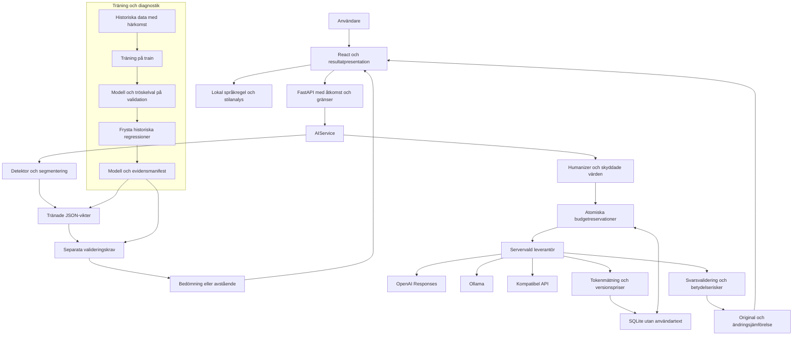

# TextLab V5: faktisk arkitektur

TextLab har två användarflöden med olika modellansvar. Detektorn kör en fryst
textklassificerare på den egna servern. Humanizern skickar en skyddad text till
en servervald generativ modell. Båda kan avstå. Ingen av dem bevisar textens
författarskap eller fullständig betydelseekvivalens.

## Komponenter

| Kod | Ansvar |
|---|---|
| `sites/src/App.jsx`, `style.css` | Två arbetslägen, resultatkort, segmentdetaljer, export, original/diff och avbrott |
| `sites/src/analyzer.mjs` | Beskrivande lokal stilanalys, Unicode-ord och meningssegmentering |
| `sites/src/detection-state.mjs` | Validera detektorsvar, separata procentgrindar och exakta källintervall |
| `sites/src/ui-state.mjs` | Validera humanizersvar/usage, rekonstruera diffar och hantera inställningar |
| `backend/main.py` | FastAPI, åtkomst före body, timeout/avbrott, API-rutter och statiska filer |
| `backend/config.py` | Serverinställningar, bakåtkompatibla namn, modellfil och budgetgränser |
| `backend/limits.py` | Delad SQLite, atomiska reservationer, idempotent avstämning och egna totalsummor |
| `ai/ai.py`, `ai/contracts.py` | AIService och Pydantic-kontrakt; modellval kan inte styras av klienten |
| `ai/detector/features.py` | Bevarad, beskrivande V4-analys med JavaScript-paritet |
| `ai/detector/linear.py` | Begränsad JSON-modell, TF-IDF och logistisk inferens i ren Python |
| `ai/detector/evidence.py` | Separata krav på dokument-, segment- och kalibreringsevidens |
| `ai/detector/runtime.py` | Språkval, dokument/segmentinferens, exakta positioner och avstående |
| `models/v5/detector.json` | Fryst pilotmodell, trösklar, härkomst och evidensmetadata |
| `ai/humanizer/` | Sex promptlägen, maskering, skydd, riskkontroller, återställning och diff |
| `ai/providers/` | OpenAI Responses, Ollama och kompatibel Chat Completions |
| `ai/usage.py`, `config/model-prices.json` | Faktiska provider-räknare och versionshanterade kostnadsuppskattningar |
| `tools/train_v5.py`, `tools/evaluate_v5.py` | Reproducerbar träning, kandidatjämförelse och fryst utvärdering |
| `data/`, `models/experimental/`, `docs/evidence/` | Bevarade korpusar, äldre modeller, råresultat och proveniens |

`backend/main.py` återexporterar fortfarande vissa äldre symboler för offlineverktyg.
Implementationen har ett hem i `ai/`. Frontend ligger kvar i `sites/`.

## Dataflöde

Den fristående diagramkällan finns i [ARCHITECTURE.mmd](ARCHITECTURE.mmd).

Diagrammet visar den implementerade piloten. Kalibrering och en ny oberoende
valideringsmängd saknas. Träningsverktyget sätter därför inte produktionsgrindarna
till godkända. Att ett artefaktformat kan bära evidens betyder inte att denna
evidens har samlats in.

## Detektorns beslutsordning

1. Frontend håller den lokala stilanalysen separat och skickar originaltext och
   `auto`, `sv` eller `en` till den egna `/api/detect`-routen.
2. Åtkomst, origin, rategräns, bytegräns och UTF-16-längd kontrolleras före analys.
   Den generativa modellen kontaktas inte och ingen generativ tokenbudget används.
3. AIService kör CPU-inferensen utanför den asynkrona eventloopen. Den servervalda
   modellfilen läses som begränsad JSON, inte pickle eller exekverbar kod. Format,
   koefficienter och integritet kontrolleras; en liten cache undviker upprepad läsning.
4. Språkregel, ordantal och meningar avgör om dokumentet kan bedömas. Ursprungliga
   meningsintervall bevaras i UTF-16. Varje användbart segment får egen inferens;
   dokumentpoängen kopieras aldrig till segmenten.
5. Fyra separata evidensgrindar avgör dokumentklass, dokumentsannolikhet,
   segmentklass och segmentsannolikhet. Saknad/ogiltig modell eller evidens
   ger null, en avståendekategori och ett begripligt skäl.
6. Textandelen beräknas enbart av validerat flaggade, icke överlappande segment.
   Exkluderade ord redovisas separat. Dokumentets klassannolikhet och textandelen
   har olika nämnare och olika betydelse.
7. Klienten kontrollerar kontrakt, intervall, textöverensstämmelse och räknare
   innan resultat visas. Ändrad text eller språk ogiltigförklarar väntande svar.

Filhashar upptäcker ofrivilliga ändringar och binder metadata till modellen.
De bevisar inte etiketternas riktighet, licens, oberoende eller att ett mått
beräknats ärligt. En administratör som installerar en annan modell måste granska
källor, träningsloggar, statistik och kalibrering. Ett handskrivet manifest får
inte behandlas som ny kvalitetsvalidering. Se [detektordokumentationen](DETECTOR_V5.md).

## Ett humanizeranrop från början till slut

1. Användaren väljer språk, ett av sex redigeringslägen och eventuella exakta
   textdelar att skydda. UI och API kontrollerar textgränserna.
2. `/api/rewrite` autentiserar TextLab-koden. Denna kod är aldrig OpenAI-nyckeln.
3. AIService maskerar identifierade ankare och sammanfogar överlappande skydd.
4. Backend reserverar token, eventuell USD-budget och en global samtidighetsplats
   i en SQLite-transaktion innan leverantörsanropet skickas.
5. Servern väljer OpenAI Responses, Ollama eller kompatibel strikt schema-API.
   HTTP- och svarsstorleksgränser gäller. Timeout/klientavbrott avbryter väntan.
6. Adaptern fångar verklig usage även när ett mottaget svar är ofullständigt eller
   felaktigt. En strängkompatibel `GenerationResult` bär text och metadata vidare.
7. Faktiska räknare stämmer av reservationen idempotent. Saknad usage lämnar
   reservationen belastad. Providerutfall bokförs separat från senare textkontroller.
8. Exakta ankare återställs och betydelserisker kontrolleras. Ett avvisat svar kan
   vara debiterbart och registreras som avvisat, inte som gratis.
9. Resultatet innehåller text, diff, skydd, begränsningar och usage. Frontend
   verifierar att diffen återskapar både original och resultat. Originalet bevaras.

`review_required: true` och `semantic_equivalence_verified: false` gäller alltid.
Språkreglerna kan upptäcka vissa fel men är ingen generell faktagranskning eller
grammatikkontroll. Någon separat AI-granskare används inte utan en konfigurerad
och utvärderad sådan integration.

## Åtkomst, lagring och kostnad

Nycklar läses enbart på backend och saknar `VITE_`-prefix. `.env` ingår inte i
Git eller imagen. Extern åtkomst kräver autentisering och tillåtna origins/hosts.
Klienten får inte välja modell, provider-URL, modellfil eller annan användares
statistik. Provider-URL:er är serverkonfiguration och följer inte omdirigeringar.

SQLite innehåller hashade kvotidentiteter, tidsstämplar, räknare, modell-ID:n,
prisversion, utfall och reservationer. Den innehåller inga originaltexter,
omskrivningar, prompts, råa providerfel eller råa åtkomsttoken. Poster äldre än
31 UTC-dygn rensas vid användning av bokföringen. `/api/usage` visar endast
anropande användares aktuella UTC-dygn och märker ofullständiga delsummor.

Alla workers på en värd använder samma fil. En död workers samtidighetslås kan
löpa ut utan att dess okända förbrukning återbetalas. Flera värdar kräver en
annan gemensam kvot-/authlösning. Lokala reservationer är inte leverantörens
faktura; även leverantörens egna kontogränser behövs.

## Evidens och reproduktion

Äldre modeller, data, råkörningar och verifieringsrapporter bevaras. V5 har egna
filer och skiljer tekniska tester, handbyggda UI-fixtures, historisk återspelning
och faktiska nya modellkörningar. Pilotens train/validation/test och alla derivats
källfamiljer hålls ihop. Historiska tester kan visa regression men blir inte nya
oberoende tester genom ett nytt filnamn. Se [MODEL_EVALUATION.md](MODEL_EVALUATION.md)
och [VERIFICATION-V5.md](VERIFICATION-V5.md).
