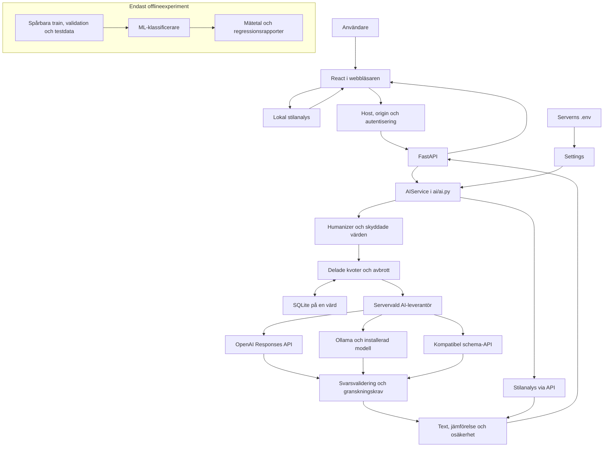

# TextLab V4: faktisk arkitektur

TextLab har två separata användarflöden. **AI-detektorn visar beskrivande
stilanalys**. **AI-humanizern föreslår språkredigering med en servervald modell**.
Ingen funktion fastställer vem som skrivit en text eller bevisar att en omskrivning
har samma betydelse.

## Komponenter

| Kod | Ansvar | Status |
|---|---|---|
| `sites/src/App.jsx` | React, två arbetslägen, textjämförelse, kopiering/export, avbrott | Aktiv |
| `sites/src/analyzer.mjs` | Lokal språkregel, segmentering, MATTR, meningsrytm, upprepningar | Aktiv, ingen nätverksöverföring av analystext |
| `sites/src/ui-state.mjs` | Validering av backendmetadata, diffar, inställningar och inmatning | Aktiv |
| `backend/main.py` | FastAPI, host/origin, åtkomst, bodygräns, timeout, avbrott och statiska filer | Aktiv |
| `backend/config.py` | Serverns miljövariabler och kompatibla äldre namn | Aktiv |
| `backend/limits.py` | Atomiska rategränser, samtidighet och dagliga reservationer i SQLite | Aktiv, en värd |
| `ai/ai.py` | `AIService.detect`, `humanize`, `provider_status` | Aktiv |
| `ai/contracts.py` | Pydantic-kontrakt för text, språk, ton och skyddade textdelar | Aktiv |
| `ai/humanizer/` | Sex promptlägen, exakta ankare, riskmarkörer, återställning och diff | Aktiv |
| `ai/providers/` | OpenAI Responses, Ollama och kompatibel Chat Completions | Aktiv när konfigurerad |
| `ai/detector/` | Beskrivande serveranalys för `/api/detect` | Aktiv, inget modell-API |
| `tools/train_baseline.py`, `tools/model_evaluate.py`, `tools/compare_classifiers.py` | Träning och utvärdering | Endast offlineexperiment |
| `models/experimental/`, `data/` | Frysta modeller, korpusar, modellkörningar och proveniens | Bevarad evidens, laddas inte i webbappen |

`backend/main.py` återexporterar några V3-symboler så befintliga offlineverktyg
fortsätter fungera. Implementationen av dem finns bara på ett ställe i `ai/`.
Frontendkatalogen heter fortsatt `sites/` för att bevara fungerande byggkonfiguration.

## Diagram

Den redigerbara källan finns i [ARCHITECTURE.mmd](ARCHITECTURE.mmd).

Webbläsarens vanliga analysknapp använder den lokala grenen. `/api/detect` är ett
extra autentiserat servergränssnitt för integrationer och skickar heller ingen text
till OpenAI eller Ollama. Det finns ingen automatisk väg från ML-experimenten till
produktionsklassificering.

## Ett omskrivningsanrop från början till slut

1. Användaren skriver svenska eller engelska, väljer ett av sex tonlägen och kan
   ange exakta textdelar att skydda. Frontend kontrollerar teckengränsen.
2. React skickar JSON till `POST /api/rewrite` med TextLab-åtkomstkod när sådan
   krävs. TextLab-koden är aldrig OpenAI-nyckeln.
3. ASGI-lagret kontrollerar åtkomst och origin innan body läses. Faktiska bodybyte
   och lästid begränsas; Pydantic validerar språk, ton och text.
4. `AIService.humanize` skyddar identifierade namn, tal, enheter, datum, citat,
   referenser, URL:er och uttryckliga textdelar med engångsmarkörer.
5. Backend reserverar en konservativ tokenbudget och en delad samtidighetsplats.
   HTTP-anrop och modellarbete har tidsgräns. Klientavbrott avbryter väntande arbete.
6. Serverns konfiguration väljer adapter och modell. OpenAI använder Responses API
   och strikt JSON-schema; Ollama använder sin lokala chatt-API med JSON-schema.
7. Ofullständiga, felaktiga eller för stora svar avvisas. Exakta markörer återställs
   och kontrolleras. Separata heuristiker söker utvalda betydelserisker.
8. Resultatet innehåller text, diff, skyddsräkning, `unchanged`, förklaring och krav
   på granskning. Om modellen återlämnar samma text bevaras originalet exakt.
9. Frontend verifierar att diffen verkligen återskapar både original och resultat
   innan den visar något. Försenade svar får inte skriva över ändrad inmatning.

`exact_values_checked: true` beskriver maskinella kontroller.
`semantic_equivalence_verified: false` är separat och får inte tolkas som sann
bara för att exakta kontroller passerade. Datum kan få fel grammatisk roll och
nya sakpåståenden kan passera heuristiker; användaren måste granska betydelsen.

## Nycklar, lagring och kostnader

`.env` läses endast av backendens konfiguration. `OPENAI_API_KEY` används i
serverns Authorization-header till OpenAI. Variabeln har inget `VITE_`-prefix,
skickas inte i API-svar och bakas inte in i frontend. `.env` ingår inte i Git
eller containerbygget. Håll privat konfiguration utanför `dist/`.

TextLab lagrar inte analystext, omskrivningar eller råa åtkomsttoken. SQLite
innehåller hashade kvotidentiteter, tidsstämplar, budgetreservationer och kortlivade
lås. Alla processer på samma värd ska använda samma fil. Flera värdar kräver en
separat, gemensam auth- och kvotlösning och stöds inte av denna SQLite-arkitektur.

Statuskontrollen är autentiserad och kan göra en liten riktig generering. Dess
framgång säger att modellen svarade på proben, inte att språk- eller betydelsekvalitet
är verifierad. Reservationer återbetalas inte vid fel/avbrott; modellleverantörens
verkliga kostnad och lagringspolicy är separata. Se [drift](DEPLOYMENT.md).

## Historisk evidens

V3-rapporter, råkörningar, korpusar och modellartefakter har bevarats. Historiska
rapporter som säger ”current validator” binds till sina sparade källkodssnapshots.
V4-resultat ska ha egna filer och får inte skrivas över gamla rapporter eller
beskriva återanvända testdata som en ny oberoende kontroll.
